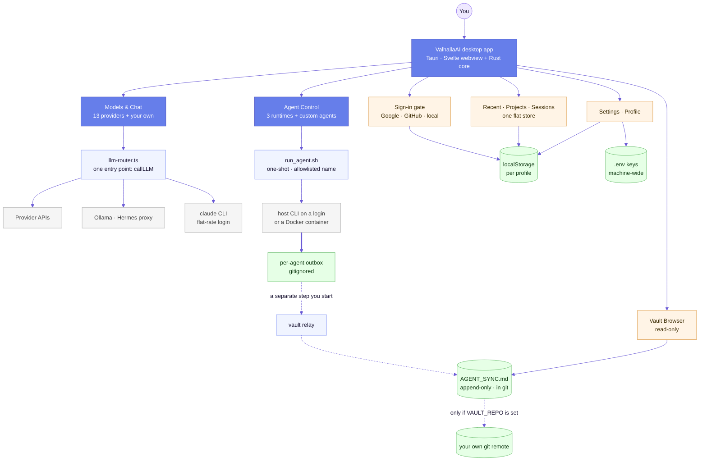
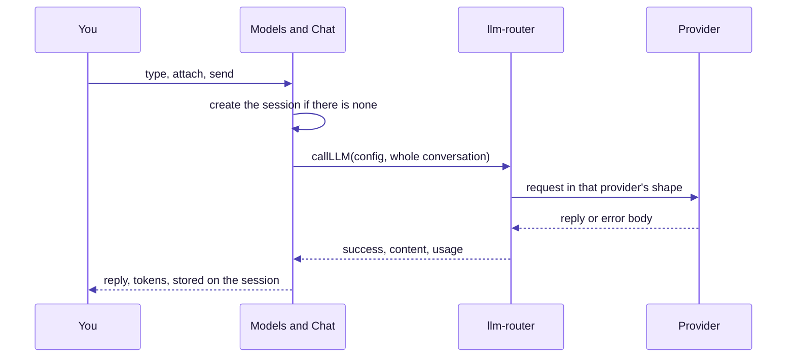
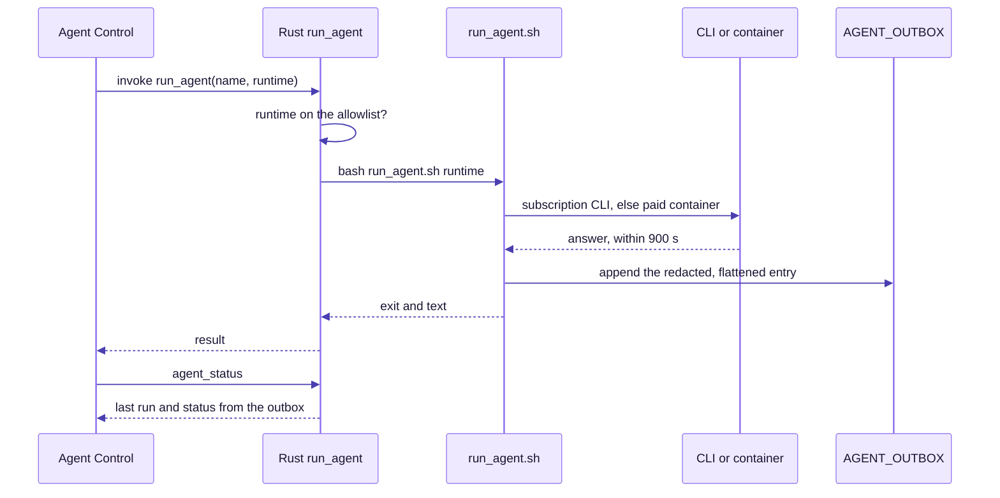
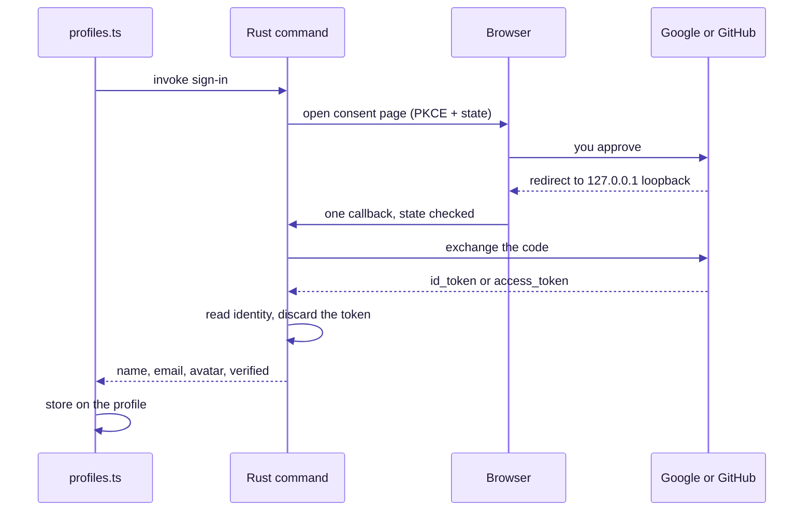
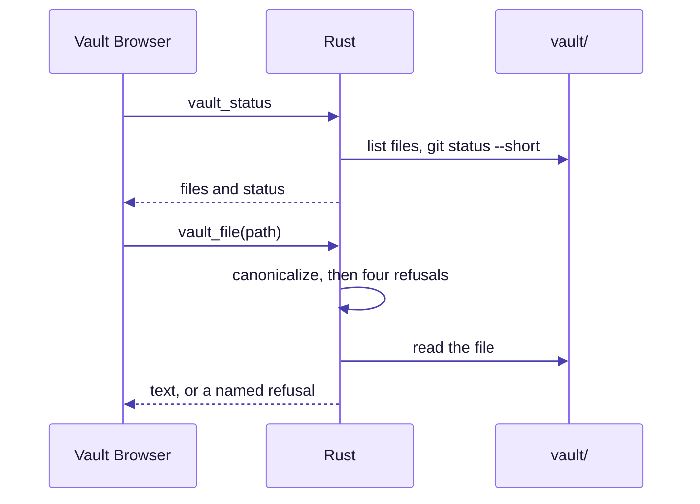
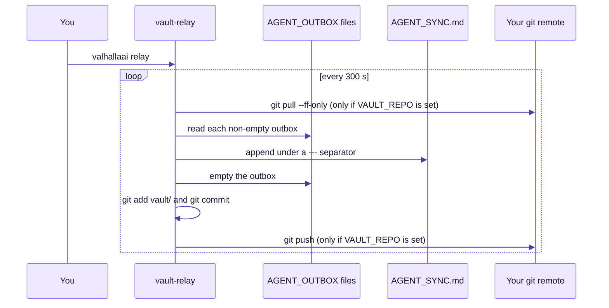
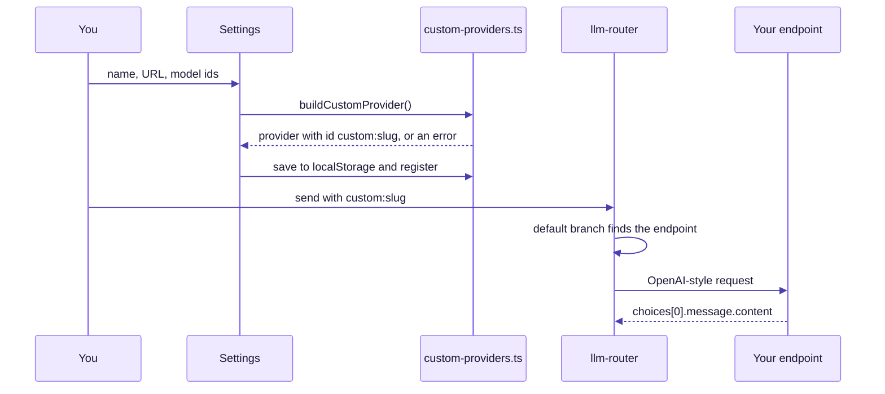

# ValhallaAI — Diagram atlas

**62 diagrams, one page of orientation.** This file is the map: the whole system on a single page, six requests traced end to end, and an index that links every other diagram in the repository. Each diagram in the documents carries a screen-reader title and description and is followed by a *Reading it* paragraph that says what to notice.

**Start here:** the system on one page → the request closest to what you are trying to understand → follow its *Detail* links into [ARCHITECTURE.md](./ARCHITECTURE.md).

## How to read the colours

| Colour | Meaning |
|---|---|
| Indigo | The live target: the thing a diagram is about |
| Light blue | Machine-side, automated work |
| Amber | A human step, or a step that needs care |
| Rose | A gate that can refuse, or an error |
| Green | The healthy outcome, or a store that holds the answer |
| Grey | Optional, planned, or not active by default |

Solid arrows are paths in use today, thick arrows are bulk or blocking, and dotted arrows are not active by default. The full legend is [ARCHITECTURE.md §2](./ARCHITECTURE.md#2-how-to-read-the-diagrams).

## The system on one page

**Reading it.** The three indigo boxes are the three jobs: chat, agents, and the screens around them. Follow the thick arrow out of the runtime: an agent writes one file, its own outbox, and nothing else. The dotted arrows after it are the part that is a separate step you start, and the final one has never run against this repository. Everything the app remembers sits in the green stores at the bottom, and none of them is a database.

## Six requests, traced

### 1. A chat message

**Reading it.** Detail: [Two attachment paths](./ARCHITECTURE.md#two-attachment-paths), [What happens when you press send](./ARCHITECTURE.md#what-happens-when-you-press-send), [How the router picks an implementation](./ARCHITECTURE.md#7-provider-catalog).
### 2. A Run click

**Reading it.** Detail: [What happens on one Run click](./ARCHITECTURE.md#511-agent-runtime-agents-scriptsrun_agentsh), [Why a Run click does not freeze the window](./ARCHITECTURE.md#why-a-run-click-does-not-freeze-the-window), [How an answer becomes an outbox entry](./ARCHITECTURE.md#how-an-answer-becomes-an-outbox-entry).
### 3. Signing in

**Reading it.** Detail: [The OAuth loopback flow](./CONTRIBUTING.md#the-oauth-loopback-flow-step-by-step), [The sign-in gate as a state machine](./ARCHITECTURE.md#the-sign-in-gate-as-a-state-machine).
### 4. Opening a vault file

**Reading it.** Detail: [Reading the vault, and what the guard refuses](./ARCHITECTURE.md#reading-the-vault-and-what-the-guard-refuses).
### 5. Folding answers into the log

**Reading it.** Detail: [One relay cycle](./ARCHITECTURE.md#one-relay-cycle), [Who reads and who writes each vault file](./ARCHITECTURE.md#who-reads-and-who-writes-each-vault-file). The push has never run against this repository.
### 6. Adding a custom provider

**Reading it.** Detail: [From a Settings form to a routable provider](./ARCHITECTURE.md#from-a-settings-form-to-a-routable-provider), [Which provider path to take](./CONTRIBUTING.md#adding-a-new-llm-provider).

## Index of every diagram

### README.md (8)

| Diagram | Type | Section |
|---|---|---|
| [Which download is for you?](./README.md#which-download-is-for-you) | flowchart | Which download is for you? |
| [ValhallaAI at a glance](./README.md#what-it-does) | flowchart | What it does |
| [What happens on first launch](./README.md#what-happens-on-first-launch) | flowchart | What happens on first launch |
| [How `valhallaai` decides what to launch](./README.md#how-valhallaai-decides-what-to-launch) | flowchart | How `valhallaai` decides what to launch |
| [The three ways through the gate](./README.md#the-three-ways-through-the-gate) | flowchart | The three ways through the gate |
| [Where one agent answer goes](./README.md#where-one-agent-answer-goes) | state | Where one agent answer goes |
| [Picking a provider](./README.md#picking-a-provider) | flowchart | Picking a provider |
| [A first triage for run problems](./README.md#a-first-triage-for-run-problems) | flowchart | A first triage for run problems |

### ARCHITECTURE.md (35)

| Diagram | Type | Section |
|---|---|---|
| [ValhallaAI system map](./ARCHITECTURE.md#3-system-map) | flowchart | 3. System map |
| [3.1 Runtime topology](./ARCHITECTURE.md#31-runtime-topology) | flowchart | 3.1 Runtime topology |
| [3.2 The ten Tauri commands](./ARCHITECTURE.md#32-the-ten-tauri-commands) | flowchart | 3.2 The ten Tauri commands |
| [4.2 Build and release paths](./ARCHITECTURE.md#42-build-and-release-paths) | flowchart | 4.2 Build and release paths |
| [5.0 How the source is layered](./ARCHITECTURE.md#50-how-the-source-is-layered) | flowchart | 5.0 How the source is layered |
| [Where an API key comes from](./ARCHITECTURE.md#where-an-api-key-comes-from) | flowchart | Where an API key comes from |
| [What a sign-in keeps and what it throws away](./ARCHITECTURE.md#what-a-sign-in-keeps-and-what-it-throws-away) | flowchart | What a sign-in keeps and what it throws away |
| [The sign-in gate as a state machine](./ARCHITECTURE.md#the-sign-in-gate-as-a-state-machine) | state | The sign-in gate as a state machine |
| [From a Settings form to a routable provider](./ARCHITECTURE.md#from-a-settings-form-to-a-routable-provider) | flowchart | From a Settings form to a routable provider |
| [Two attachment paths](./ARCHITECTURE.md#two-attachment-paths) | flowchart | Two attachment paths |
| [What happens when you press send](./ARCHITECTURE.md#what-happens-when-you-press-send) | sequence | What happens when you press send |
| [One flat list, three filtered views](./ARCHITECTURE.md#one-flat-list-three-filtered-views) | flowchart | One flat list, three filtered views |
| [The life of an agent card](./ARCHITECTURE.md#the-life-of-an-agent-card) | state | The life of an agent card |
| [A custom agent is a name bound to a runtime](./ARCHITECTURE.md#a-custom-agent-is-a-name-bound-to-a-runtime) | flowchart | A custom agent is a name bound to a runtime |
| [How a task becomes a prompt](./ARCHITECTURE.md#how-a-task-becomes-a-prompt) | flowchart | How a task becomes a prompt |
| [What happens on one Run click](./ARCHITECTURE.md#511-agent-runtime-agents-scriptsrun_agentsh) | flowchart | 5.11 Agent Runtime (`agents/*`, `scripts/run_agent.sh`) |
| [How an answer becomes an outbox entry](./ARCHITECTURE.md#how-an-answer-becomes-an-outbox-entry) | flowchart | How an answer becomes an outbox entry |
| [Reading the vault, and what the guard refuses](./ARCHITECTURE.md#reading-the-vault-and-what-the-guard-refuses) | flowchart | Reading the vault, and what the guard refuses |
| [The shell, screen by screen](./ARCHITECTURE.md#the-shell-screen-by-screen) | flowchart | The shell, screen by screen |
| [One chat message, drop path](./ARCHITECTURE.md#61-sending-a-chat-message) | sequence | 6.1 Sending a chat message |
| [How a failed response becomes a readable error](./ARCHITECTURE.md#61-sending-a-chat-message) | flowchart | 6.1 Sending a chat message |
| [Why a Run click does not freeze the window](./ARCHITECTURE.md#why-a-run-click-does-not-freeze-the-window) | sequence | Why a Run click does not freeze the window |
| [How the router picks an implementation](./ARCHITECTURE.md#7-provider-catalog) | flowchart | 7. Provider catalog |
| [How each provider authenticates and bills](./ARCHITECTURE.md#how-each-provider-authenticates-and-bills) | flowchart | How each provider authenticates and bills |
| [The Nous Portal path](./ARCHITECTURE.md#the-nous-portal-path) | sequence | The Nous Portal path |
| [Chat on the subscription default, end to end](./ARCHITECTURE.md#chat-on-the-subscription-default-end-to-end) | flowchart | Chat on the subscription default, end to end |
| [Why an agent run took three minutes](./ARCHITECTURE.md#81-where-the-time-went) | flowchart | 8.1 Where the time went |
| [The measured ladder](./ARCHITECTURE.md#the-measured-ladder) | bar chart | The measured ladder |
| [Who reads and who writes each vault file](./ARCHITECTURE.md#who-reads-and-who-writes-each-vault-file) | flowchart | Who reads and who writes each vault file |
| [Agent run to coordination log, with the relay step](./ARCHITECTURE.md#92-the-full-agent-and-vault-picture) | sequence | 9.2 The full agent-and-vault picture |
| [One relay cycle](./ARCHITECTURE.md#one-relay-cycle) | flowchart | One relay cycle |
| [Trust boundaries and guards](./ARCHITECTURE.md#10-security-model) | flowchart | 10. Security model |
| [10.1 Where a credential travels](./ARCHITECTURE.md#101-where-a-credential-travels) | flowchart | 10.1 Where a credential travels |
| [The four deployment stages](./ARCHITECTURE.md#11-deployment-path-future) | flowchart | 11. Deployment path (future) |
| [Platform dependency order](./ARCHITECTURE.md#111-platform-roadmap-beyond-macoswindowslinux-desktop) | flowchart | 11.1 Platform roadmap (beyond macOS/Windows/Linux desktop) |

### CONTRIBUTING.md (9)

| Diagram | Type | Section |
|---|---|---|
| [Which provider path to take](./CONTRIBUTING.md#adding-a-new-llm-provider) | flowchart | Adding a new LLM provider |
| [What CI does on every push](./CONTRIBUTING.md#what-ci-does-on-every-push) | flowchart | What CI does on every push |
| [The GUI PATH trap, in one picture](./CONTRIBUTING.md#the-gui-path-trap-in-one-picture) | flowchart | The GUI PATH trap, in one picture |
| [How one localStorage key becomes per-profile](./CONTRIBUTING.md#profiles-and-per-profile-storage) | flowchart | Profiles and per-profile storage |
| [The OAuth loopback flow, step by step](./CONTRIBUTING.md#the-oauth-loopback-flow-step-by-step) | sequence | The OAuth loopback flow, step by step |
| [How the app finds the checkout](./CONTRIBUTING.md#how-the-app-finds-the-checkout) | flowchart | How the app finds the checkout |
| [The Docker services and what they mount](./CONTRIBUTING.md#the-docker-services-and-what-they-mount) | flowchart | The Docker services and what they mount |
| [Checking a model id against reality](./CONTRIBUTING.md#checking-a-model-id-against-reality) | flowchart | Checking a model id against reality |
| [The three checks, and what each one actually covers](./CONTRIBUTING.md#before-claiming-something-works) | flowchart | Before claiming something works |

### POSITIONING.md (3)

| Diagram | Type | Section |
|---|---|---|
| [How fresh each claim in this document is](./POSITIONING.md#why-valhallaai-positioning-differentiation) | flowchart | Why ValhallaAI — Positioning & Differentiation |
| [Where each tool sits](./POSITIONING.md#21-two-honest-limits-inside-valhallaais-own-checkmarks) | quadrant chart | 2.1 Two honest limits inside ValhallaAI's own checkmarks |
| [Does ValhallaAI fit you](./POSITIONING.md#4-who-this-is-for-and-who-should-not-use-it) | flowchart | 4. Who this is for — and who should not use it |

